# Linux CLI Basics

**Path:** Pre Security (SEC0) — Operating Systems Basics module
**Room:** Linux CLI Basics
**Status:** Completed
**Date completed:** Nov 21, 2026

## 1. Objective
Build job-ready Linux terminal skills on a live Ubuntu system: navigate the filesystem, locate and read files, read permission listings, and gather a basic system report (current user, kernel, distribution) — the everyday command-line tasks used in IT support, help desk, and junior system administration roles.

## 2. Tools used
- TryHackMe AttackBox — Ubuntu 24.04.1 LTS virtual machine
- GNOME Terminal (bash shell)
- Core commands: `pwd`, `ls`, `cd`, `cat`, `find`, `whoami`, `uname`

**Skills demonstrated:** Linux CLI navigation · file and directory management · reading file permissions (`rwx`, hidden dotfiles) · locating files across a directory tree · gathering system information · error-driven troubleshooting (diagnosing path and command errors from terminal output)

## 3. Commands / steps taken
1. Started the Ubuntu VM and opened a terminal (`ubuntu@tryhackme`).
2. Oriented myself: `pwd` showed `/home/ubuntu`; `ls` listed the home folder (Desktop, Documents, Downloads, logs, projects, snap, and the standard folders); `ls -1` printed the same list one entry per line.
3. Ran `ls -al` for the long listing — permissions, owners, sizes and dates — which also revealed the hidden dotfiles (`.bashrc`, `.ssh`, `.cache`, and others) that a plain `ls` doesn't show.
4. First task — find the mission brief: `find ~ -name mission_brief.txt` located it at `/home/ubuntu/Documents/.research/archive/mission_brief.txt`.
5. Practised moving around: `cd Documents/`, confirmed the location with `pwd`, then `cd ..` back up to the home folder.
6. Hit an error worth learning from: `cat mission_brief.txt` from the home folder returned "No such file or directory" — `cat` only looks in the current directory unless it is given a path. I re-ran `find` and read the brief using its full path. The brief asked for a small system report: who I'm logged in as, the kernel version, total disk space, and the name of the distribution.
7. Collected the report: `whoami` returned `ubuntu`; `uname -a` and `uname` gave the kernel and system details; then in `/etc`, `cat os-release` identified the distribution as Ubuntu 24.04.1 LTS (Noble Numbat).
8. Final task — find the day report: `find ~ -name day1_report.txt` located `/home/ubuntu/.logs/archive/day1_report.txt`. Two more path lessons on the way in: `cd` aimed at the file itself returned "Not a directory" (`cd` is only for folders), and a typo'd path (`achive`) returned "No such file or directory". With the path corrected, I moved into the archive folder and `cat day1_report.txt` completed the room.

### Errors I hit — and how I fixed them
1. **`cat: mission_brief.txt: No such file or directory`** — I ran `cat` from my home folder, but the file was buried in a hidden folder elsewhere; `cat` only looks in the current directory unless it is given a path. **Fix:** used `find ~ -name mission_brief.txt` to get the file's exact location, then read it with the full path: `cat /home/ubuntu/Documents/.research/archive/mission_brief.txt`.
2. **`bash: cd: /home/ubuntu/.logs/archive/day1_report.txt: Not a directory`** — I tried to `cd` into the report file itself, but `cd` changes into directories, not files. **Fix:** `cd` into the folder that holds the file (`/home/ubuntu/.logs/archive`), then ran `cat day1_report.txt` from inside it.
3. **`bash: cd: /home/ubuntu/.logs/achive: No such file or directory`** — a typo in the path ("achive" instead of "archive"). **Fix:** checked the path against the `find` output and retyped it correctly.

The pattern across all three: the terminal says exactly what is wrong — wrong folder, wrong target, wrong spelling — and every fix came from reading the error and correcting course, not from retrying blindly.

### Screenshots from the lab

The Ubuntu VM desktop at the start of the room:

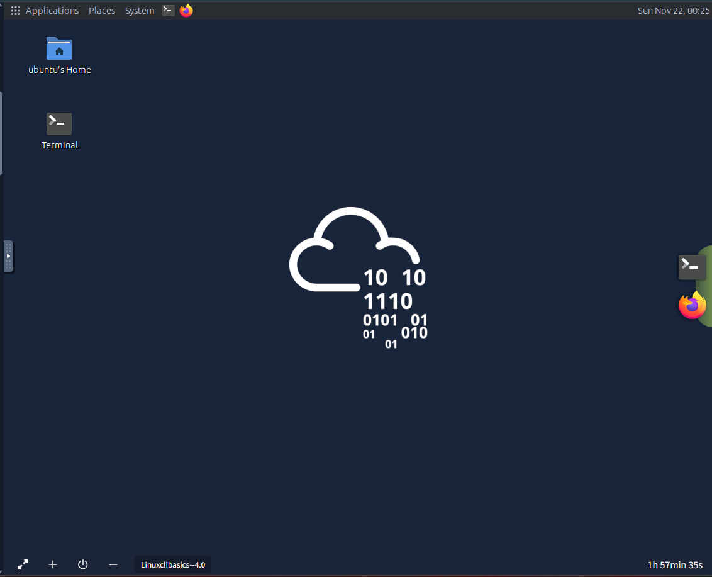

A fresh terminal, ready to work:

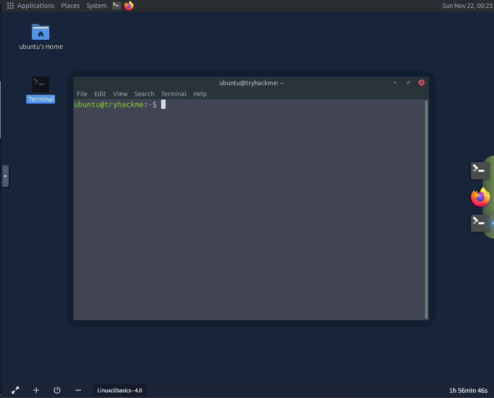

First commands — `pwd`, `ls` and `ls -1` in the home folder:

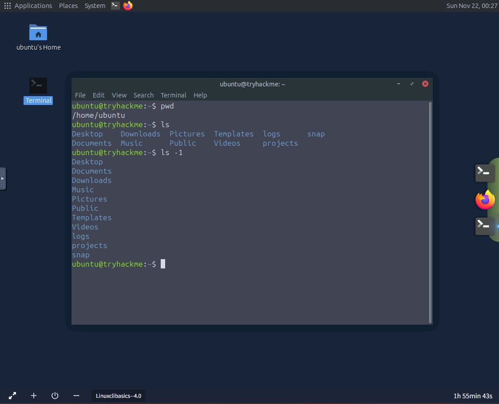

`ls -al` — the long listing with permissions and hidden files:

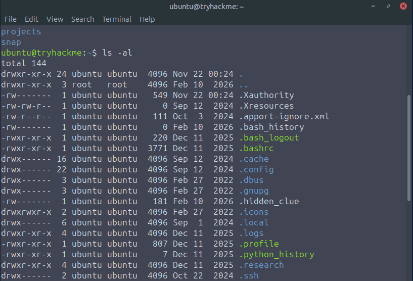

The rest of the `ls -al` listing, scrolled:

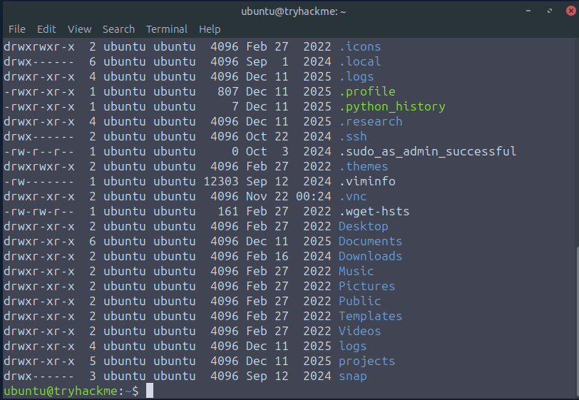

`find` locates the mission brief in the hidden `.research/archive` path:

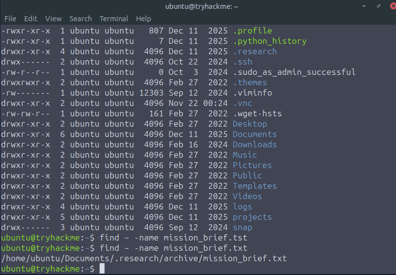

Moving with `cd`, the failed `cat` from the wrong folder, and `find` again:

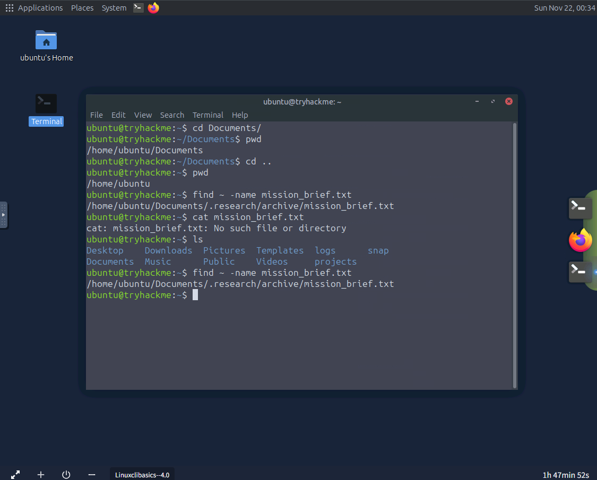

The system report — `whoami` and `uname -a`:

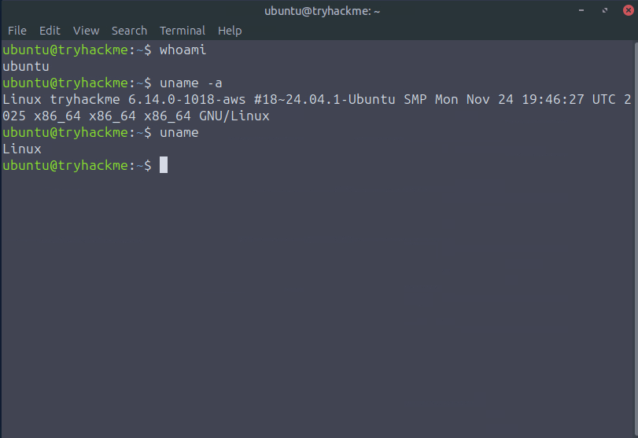

`cat os-release` in `/etc` — Ubuntu 24.04.1 LTS:

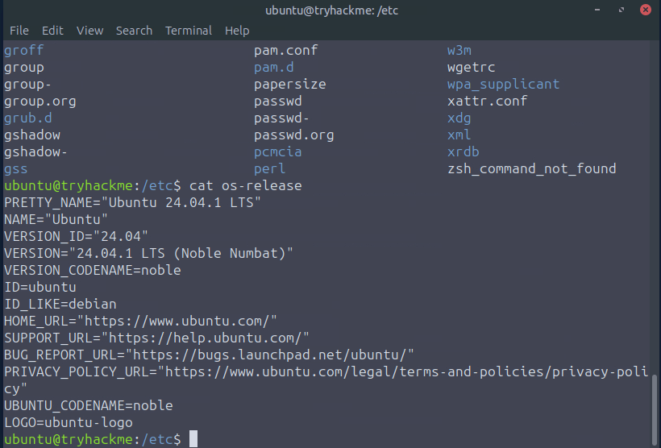

The final task — `find` locates `day1_report.txt`, and `cd` aimed at the file itself returns "Not a directory":

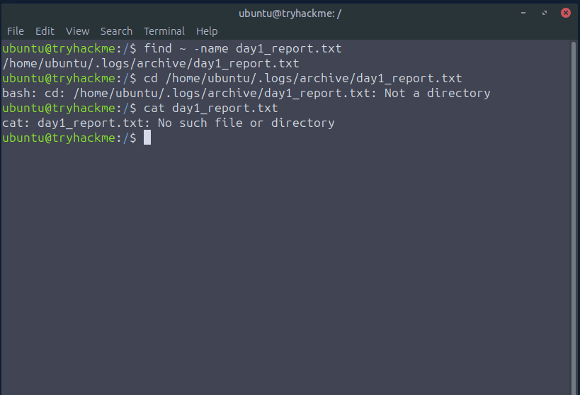

Working through the errors — fixing the path, getting into the archive folder, and completing the room:

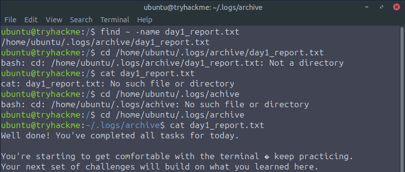

## 4. Key takeaway
A small set of commands — `pwd`, `ls`, `cd`, `cat`, `find` — does most day-to-day terminal work, and the error messages are the teacher: "No such file or directory" and "Not a directory" are path problems with exact fixes — be in the right folder, or use `find` and the full path. That habit — read the error, diagnose, correct — is the core of real IT support work, where locating files, checking system details, and reading permissions on a Linux box are daily tasks, and it is the foundation the rest of this path (and Linux system administration generally) builds on.
