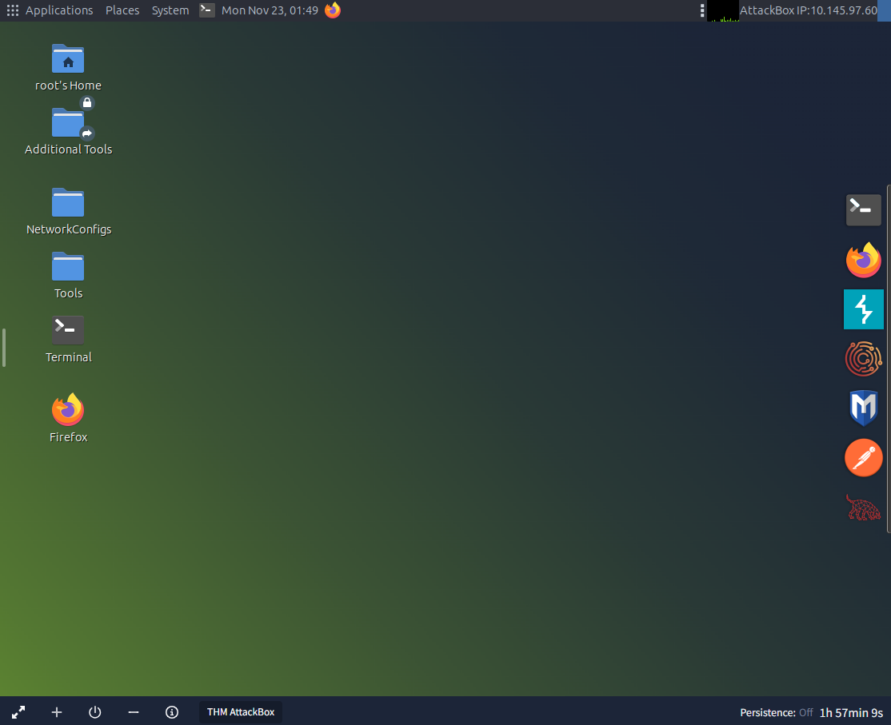
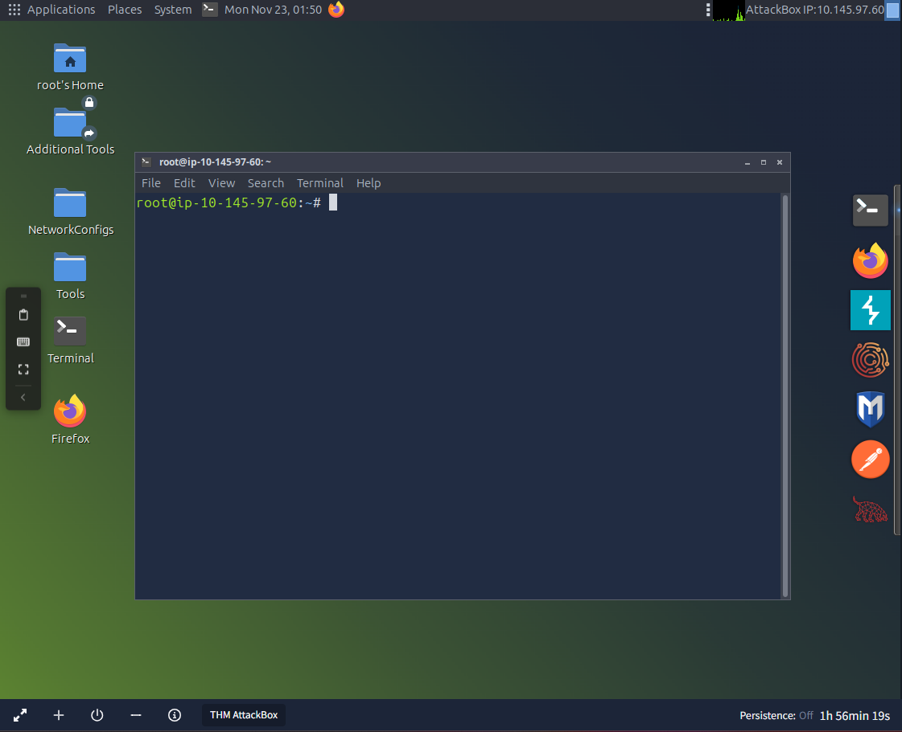
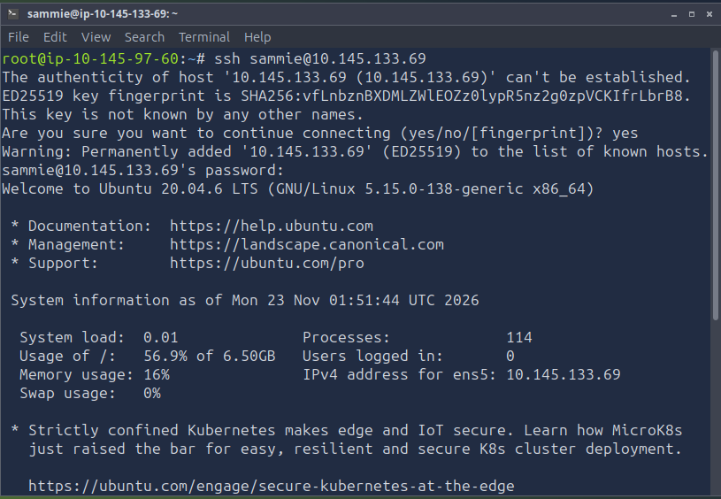
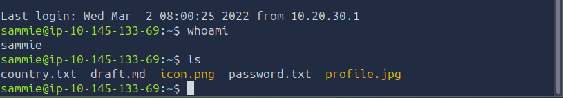
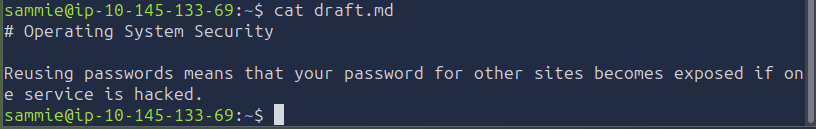
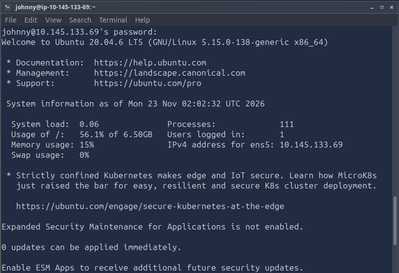
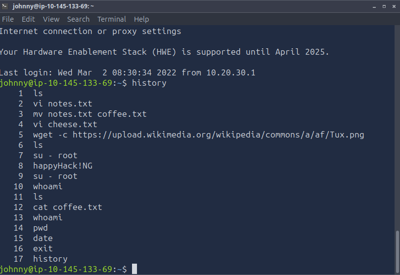
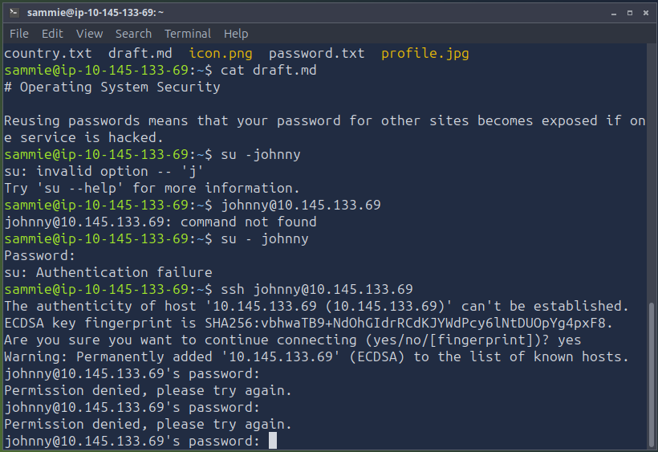
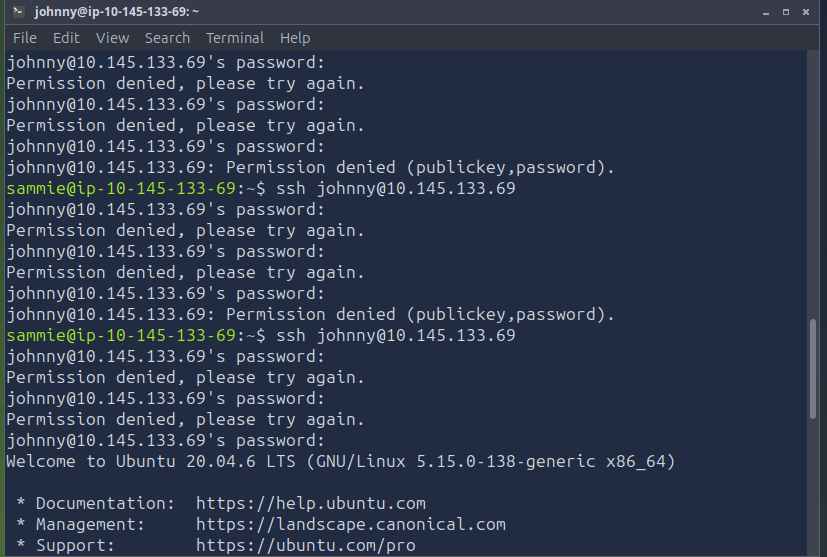

# Operating System Security

**Path:** Pre Security (SEC0) — Operating Systems module
**Status:** Completed — Nov 22, 2026
**Profile:** https://tryhackme.com/p/tt4lal

## Objective
Learn how operating systems actually get compromised — not through exotic exploits, but through everyday credential mistakes: weak passwords, reused passwords, passwords written down, and passwords left sitting in plaintext where anyone with basic access can find them. Working from the TryHackMe AttackBox, I broke into a Linux machine step by step: logged in as one user, explored, switched to a second user, and escalated all the way to root.

**Skills demonstrated:** SSH remote login, Linux user switching (su vs ssh), reading shell history as an information source, password hygiene failures (reuse, weak passwords, plaintext storage), privilege escalation, and the defensive controls that stop each step.

## Tools used
- TryHackMe AttackBox (Linux, root terminal)
- Target machine: Ubuntu 20.04.6 LTS (10.145.133.69)
- ssh, su, whoami, ls, cat, history

## Commands / steps taken
1. Started the AttackBox and the lab machine, opened a terminal, and connected to the target as the first user: `ssh sammie@10.145.133.69`. The scenario: a sticky note left sammie's password as one of two weak candidates — "dragon" or "sammie". One of them worked. First lesson of the room: a guessable password plus no lockout policy is an open door.

2. Confirmed who I was with `whoami` (sammie) and listed the home folder with `ls`: country.txt, draft.md, icon.png, password.txt, profile.jpg.

3. Read the notes file with `cat draft.md` — titled "Operating System Security," its point was the room in one sentence: *reusing passwords means your password for other sites becomes exposed if one service is hacked.*

4. Pivoted to the second user, johnny (the route there was not clean — see Errors). Once in as johnny, I checked his shell history with `history` — and there it was: among his old commands (`vi notes.txt`, a `wget` download, repeated `su - root` attempts) sat a line that was plainly a password typed at the wrong moment: `happyHack!NG`. Anything typed into a terminal can be recorded in history — including secrets.

5. Ran `su - root` and entered that password: root shell. Listed the root folder with `ls /root` and read the flag with `cat /root/flag.txt`. Full compromise: sticky note → weak password → second user → password in shell history → root. *(The screenshot of the flag is kept local only.)*

## Errors I hit — and how I fixed them
- **`su -johnny` → "su: invalid option -- 'j'"**: I missed the space — `su` reads `-johnny` as flags. Correct form: `su - johnny`.

- **Typing `johnny@10.145.133.69` as a command → "command not found"**: that's an SSH address, not a command — it needs `ssh` in front of it.
- **`su - johnny` → "Authentication failure" and repeated SSH "Permission denied"**: wrong password candidates. There was no lockout stopping me, so I kept working through candidates until one succeeded — which is itself the security lesson: without attempt limits or MFA, guessing is just a matter of time.

## What this room is used for in the real world
This exact chain is how real machines get owned. Breach investigations constantly find the same ingredients: passwords reused across services (one site's leak unlocks everything else — credential stuffing), passwords on sticky notes or in shared documents, secrets stored in plaintext files and shell history, and accounts with far more privilege than they need. Defensively, the room is a checklist of controls every IT and security team enforces: unique passwords backed by a password manager, multi-factor authentication, account lockout after failed attempts, key-based SSH instead of password logins, least-privilege accounts, and treating shell history and home folders as sensitive. For help desk and IT support work, it's the "why" behind the rules technicians apply daily — why password resets verify identity, why MFA enrolment matters, and why you never leave credentials written down.

## Key takeaway
Operating systems rarely fall to exotic exploits — they fall to people problems stored in technical places: a password on a sticky note, the same password reused everywhere, a secret typed into a terminal and kept in its history forever. The technical skills here (SSH, su, reading history) were simple; the real lesson is that hygiene and policy — unique passwords, MFA, lockouts after failed attempts, least-privilege accounts — are what actually keep a system safe.

## Screenshots (local-only list)
- images/os-sec-01-attackbox.png — the AttackBox desktop
- images/os-sec-02-terminal.png — terminal open on the AttackBox
- images/os-sec-03-ssh-sammie.png — SSH login as sammie
- images/os-sec-04-sammie-ls.png — whoami and the home folder listing
- images/os-sec-05-draft-md.png — the password-reuse note in draft.md
- images/os-sec-06-su-errors.png — the su syntax and authentication errors
- images/os-sec-07-ssh-johnny-retries.png — repeated SSH permission denied
- images/os-sec-08-johnny-login.png — logged in as johnny
- images/os-sec-09-history.png — johnny's shell history, password in plaintext
- LOCAL ONLY (flag visible): images/os-sec-10-root-flag.png
