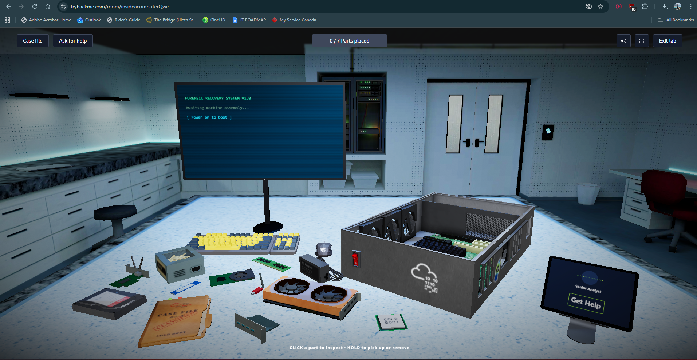
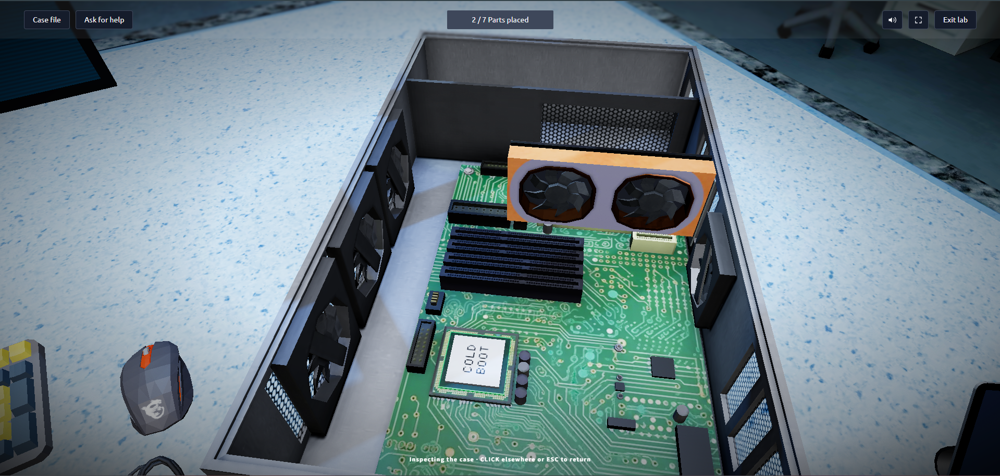
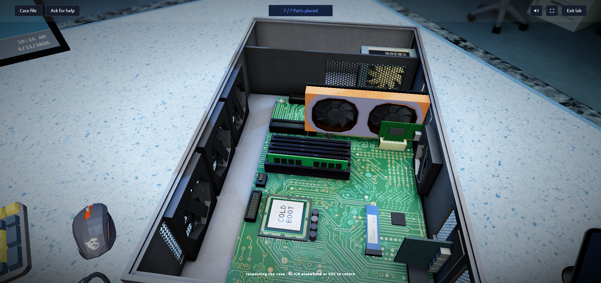
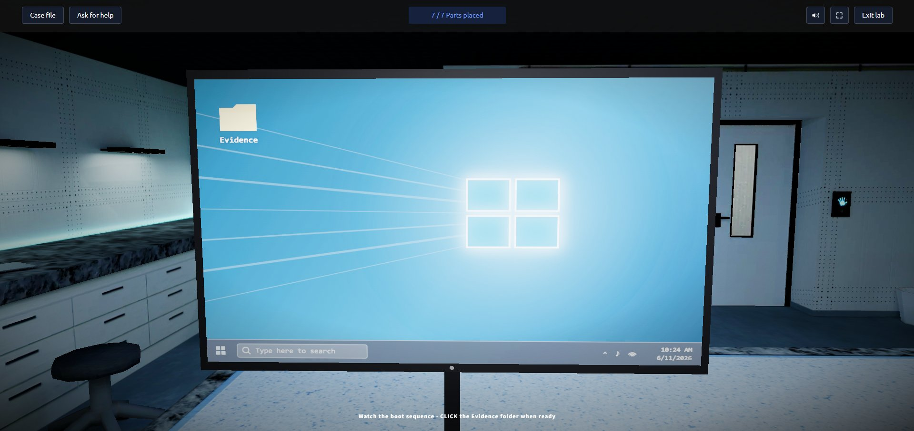

# PC Repair Lab — Cold Boot Forensic Lab Investigation (Intro to Cyber Security module)

**Path:** Pre Security (SEC0) — Introduction to Cyber Security module
**Room:** Inside a Computer (Cold Boot forensic lab)
**Status:** Completed
**Date completed:** Nov 13, 2026

## 1. Objective
Diagnose and rebuild a faulty PC in a virtual forensic lab, working only with the 7 parts available on the bench, then boot the recovered machine and retrieve the evidence stored on it — while learning in depth how a PC's components work together.

## 2. Tools used
- TryHackMe virtual lab environment (simulated PC and workbench)
- The 7 replacement parts provided on the table in the lab
- The lab's Forensic Recovery System console

## 3. Commands / steps taken
1. Inspected the faulty machine and the parts on the bench, and worked through the components to isolate the failure.
2. Identified the storage unit as the problem — it was outdated.
3. Assembled the machine part by part from the 7 bench parts (CPU, GPU, RAM, storage and the remaining components), checking the parts-placed counter as each component went in.
4. With all 7 parts placed, powered the machine on and let it boot into the operating system.
5. Opened the Evidence folder on the recovered machine and read the forensic recovery report, which confirmed the cold boot image had been retrieved successfully and the evidence flag extracted from memory.

### Screenshots from the lab

The bench at the start — the empty case, the 7 parts available, and the Forensic Recovery System waiting for the machine to be assembled:

Assembly under way — CPU and graphics card seated on the motherboard (2 of 7 parts placed):

The finished build — all 7 parts placed:

The recovered machine booted, with the Evidence folder ready to open:

## 4. Key takeaway
Component-level diagnosis is a method, not guesswork: understand how each part works, isolate the one that's failing, replace it, and verify — then confirm the recovered system actually gives up its data. These are directly transferable skills for real-world IT support desk roles, where faulty drives and hardware swaps are everyday first-line work, and the cold boot angle shows why a machine's memory matters in forensic recovery.
