# Windows CLI Basics

**Path:** Pre Security (SEC0) — Operating Systems module
**Status:** Completed — Nov 22, 2026
**Profile:** https://tryhackme.com/p/tt4lal

## Objective
Build working fluency in the Windows Command Prompt — the interface IT support technicians use daily on Windows machines. Navigate the file system entirely from the command line, locate a file buried deep in a folder tree, read it, and then inventory the machine itself: who I'm logged in as, the computer's name, its Windows version, and its IP configuration.

**Skills demonstrated:** Command Prompt navigation (cd, dir, dir /a, dir /s), recursive file search, reading files with type, system inventory with whoami, hostname, systeminfo and ipconfig, and methodical troubleshooting of path and permissions errors.

## Tools used
- TryHackMe Windows virtual machine (Windows Server 2019 Datacenter, Amazon EC2 t3a.medium)
- Command Prompt (Administrator)

## Commands / steps taken

### Task 1 — Navigate the file system and find task_brief.txt
1. Opened Command Prompt on the Windows VM and confirmed where I was standing with `cd` (with no arguments it prints the current directory): `C:\Users\Administrator`.

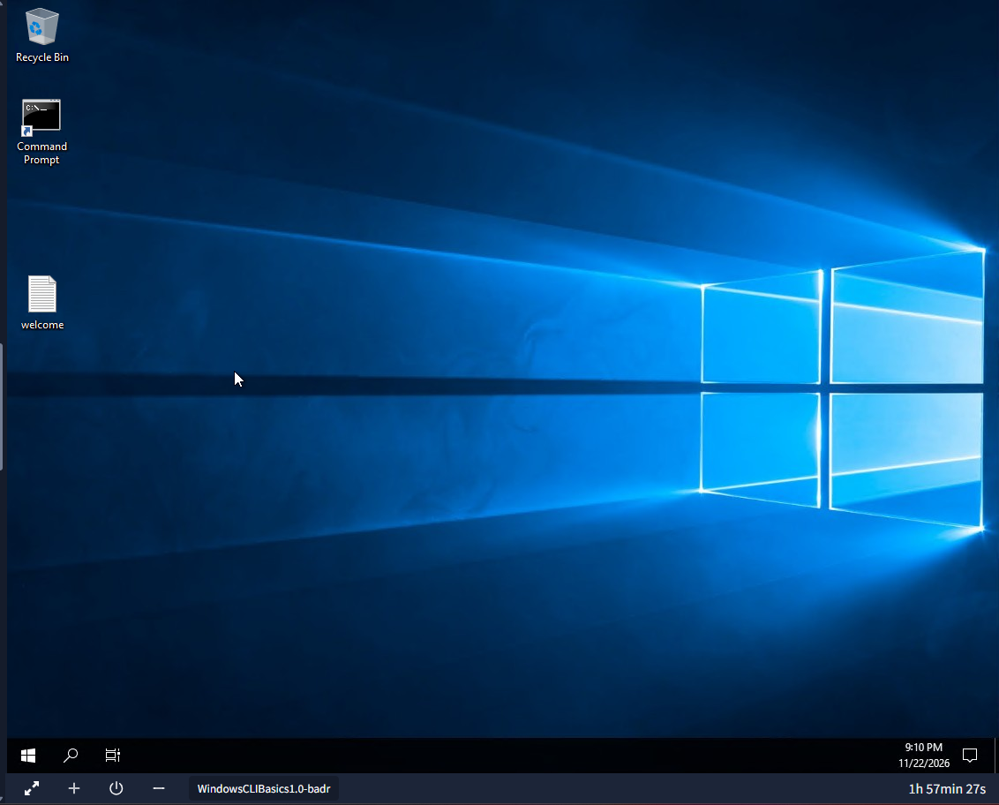

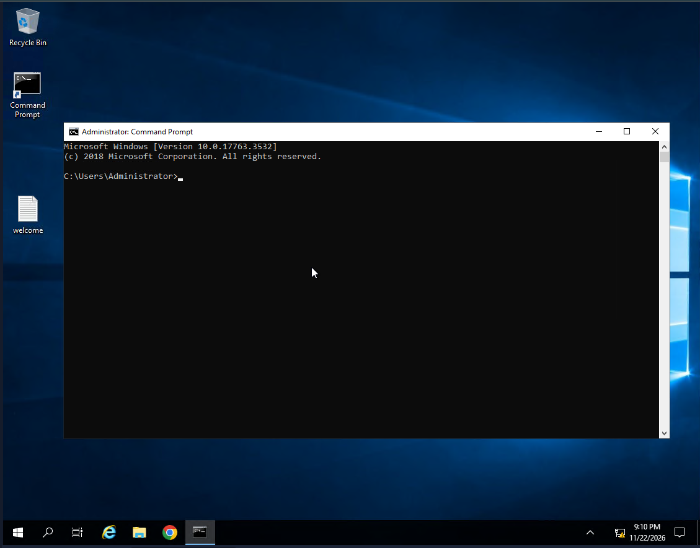

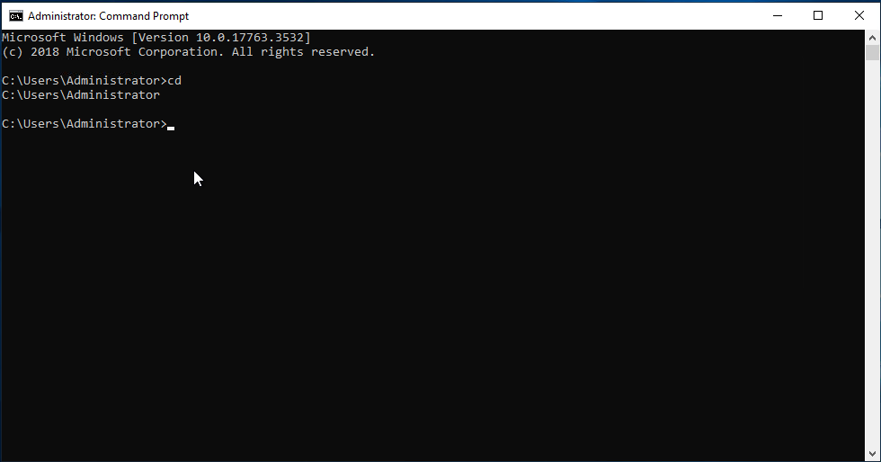

2. Listed the folder contents with `dir`, then ran `dir /a` to reveal everything Windows hides by default — hidden folders like AppData, system files like NTUSER.DAT, and the legacy folder junctions.

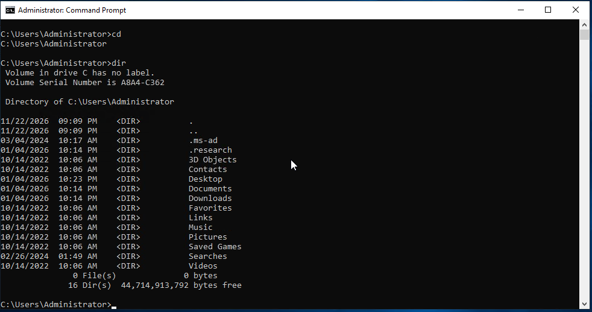

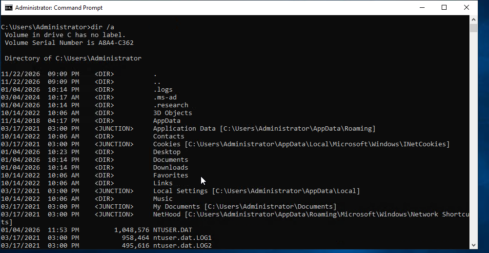

3. Searched the entire Documents tree for the target file with `dir /s task_brief.txt`. The recursive search found exactly one copy, deep in a nested path: `C:\Users\Administrator\Documents\Notes\research_yn6\exports_imv\screenshots\notes_wi6\task_brief.txt` (220 bytes).

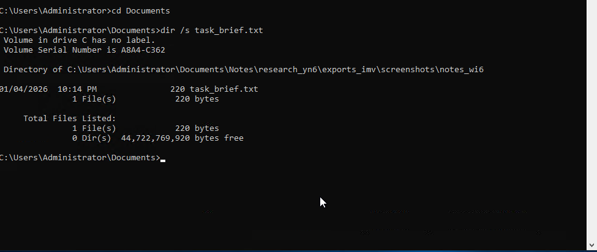

4. Navigated down the folder chain one level at a time with `cd` — Documents → Notes → research_yn6 → exports_imv → screenshots → notes_wi6 — and confirmed arrival with `dir`, which listed task_brief.txt in the folder with me.

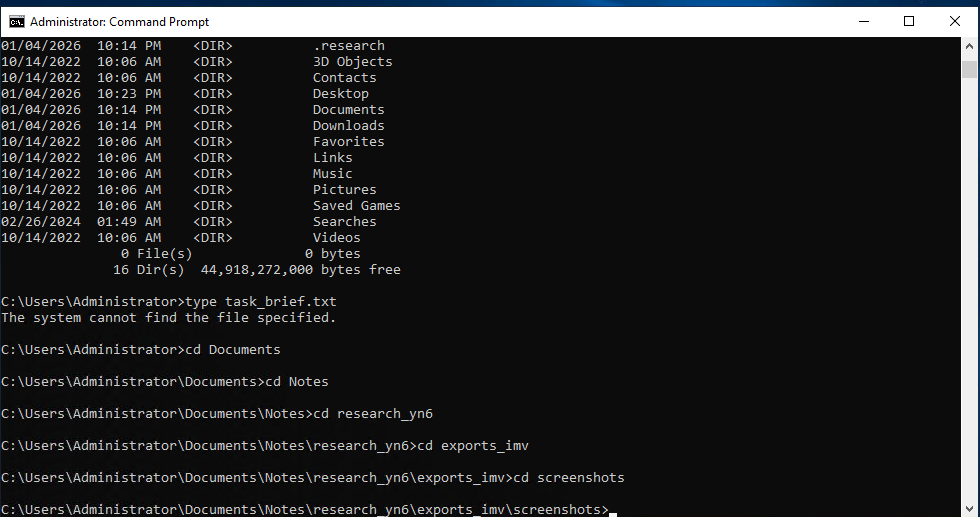

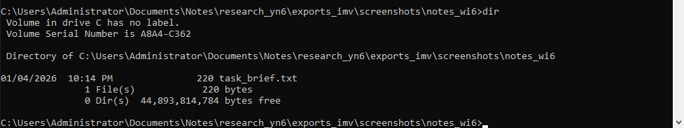

5. Read the file with `type task_brief.txt` and retrieved the flag. *(The screenshot of the file's contents is kept local only, because it shows the flag.)*

### Task 2 — Inventory the machine: user, hostname, Windows version, IP address
The task_brief set four checks, all run from the same Command Prompt session:
1. **Who am I logged in as:** `whoami` → `thmlab\administrator`.
2. **Computer name:** `hostname` → `thmlab`.
3. **Windows version and system profile:** `systeminfo` → Microsoft Windows Server 2019 Datacenter, version 10.0.17763 (Build 17763), standalone server in the WORKGROUP domain, 4,048 MB total physical memory, system boot time and install date — the full hardware and OS profile a technician captures when documenting a machine.
4. **IP configuration:** `ipconfig` → IPv4 address 10.146.164.46, subnet mask 255.255.192.0, default gateway 10.146.128.1 — the first thing to check when a machine "can't connect."

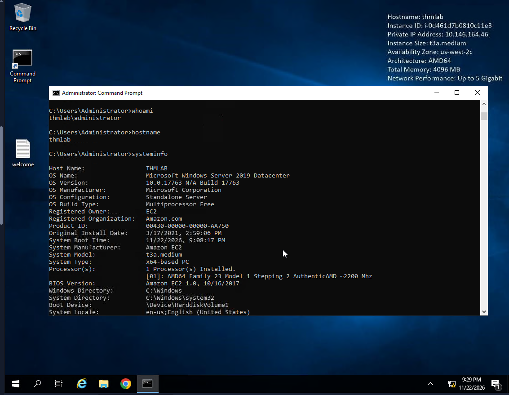

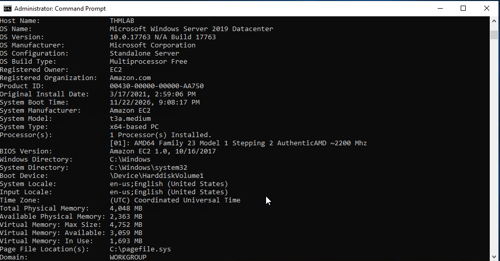

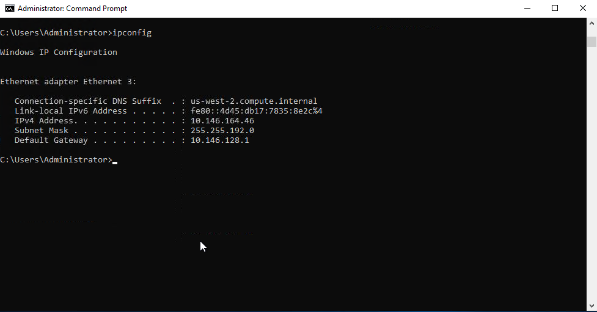

## Errors I hit — and how I fixed them
Task 1 fought back at the last step. I had the file's full path from the `dir /s` search, but my first attempts to read it kept failing:

- **`type` aimed at the folder path returned "Access is denied"** — I was pointing the command at the folder (ending at notes_wi6) instead of the file inside it.
- **Mixing the long path with a bare filename returned "The system cannot find the file specified"** — the shell resolves relative names from the folder I'm standing in, and I wasn't standing in the right one.

**How I solved it:** I stopped fighting the long path, `cd`'d down the folder chain one level at a time — following the exact path the `dir /s` search had given me — ran `dir` to confirm the file was in the folder with me, and only then ran `type task_brief.txt`, which worked immediately.

**What I learned:** commands act on exactly what you point them at — a folder is not the file inside it. It's the same lesson the Linux room taught me in mirror image (there, `cd` aimed at a file failed with "Not a directory"). When a long path misbehaves, walk the tree step by step and verify each level instead of retyping the whole path and hoping.

## Key takeaway
The Windows CLI mirrors the Linux CLI concept for concept — cd/dir/type/ipconfig do the jobs of pwd/ls/cat/ifconfig — so file-system thinking transfers between operating systems; only the command names change. And the four Task 2 commands (whoami, hostname, systeminfo, ipconfig) are the standard first checks a support technician runs on any Windows machine: who's logged in, what the machine is called, what it's running, and how it's connected.
